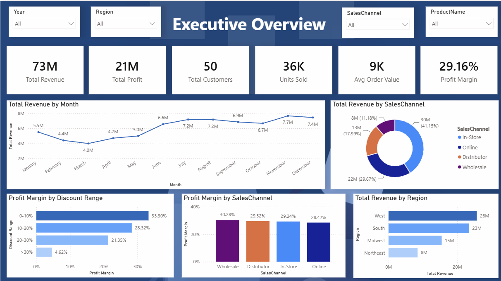
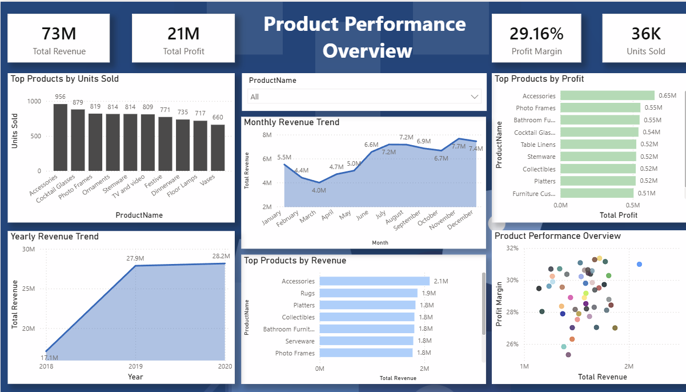

# End-to-End Retail Sales Intelligence Platform

## Table of Contents

- [Project Background](#project-background)
- [Executive Summary](#executive-summary)
- [Insights Deep-Dive](#insights-deep-dive)
  - [Overall Business Performance](#overall-business-performance)
  - [Sales Channel Performance](#sales-channel-performance)
  - [Regional Performance](#regional-performance)
  - [Discount Impact on Profitability](#discount-impact-on-profitability)
  - [Delivery & Supply Chain Performance](#delivery--supply-chain-performance)
  - [Monthly Revenue Trends](#monthly-revenue-trends)
- [Recommendations](#recommendations)
- [Assumptions and Caveats](#assumptions-and-caveats)

---

## Project Background

Every retail business collects thousands of sales records, but raw data alone doesn't explain what's actually driving performance. This project explores historical retail sales data to understand where revenue comes from, which sales channels are the most profitable, how discounts affect profit, and whether the supply chain is operating efficiently.

## Executive Summary

This analysis covers 7,987 retail transactions, generating $73.13M in revenue and $21.33M in profit, with an overall profit margin of 29.16%.

The business performs consistently across regions and maintains healthy profitability overall. However, the analysis shows that the highest revenue doesn't always come from the most profitable sales channel. While In-Store sales generate the largest share of revenue, Wholesale delivers the highest profit margin, making it an efficient channel despite lower sales volume.

Discount analysis revealed that larger discounts significantly reduce profitability. Orders with discounts above 30% produce a profit margin of only 4.62%, compared to 33.3% for orders with discounts below 10%.

Delivery performance remains consistent across sales channels and warehouses, suggesting a stable supply chain without major operational bottlenecks.

Overall, the analysis highlights opportunities to improve pricing decisions, strengthen high-margin sales channels, and continue monitoring monthly revenue trends to support future business planning.

## Dashboard Overview

### Executive Overview

### Product Performance Overview

## Insights Deep-Dive

### Overall Business Performance

- Analyzed 7,987 retail transactions spanning 2018–2020.
- Generated $73.13M in total revenue and $21.33M in total profit.
- Maintained an overall profit margin of 29.16%, indicating consistent profitability across the business.
- Revenue was nearly 3.4× higher than total cost ($51.80M), providing a healthy return on sales.

### Sales Channel Performance

- In-Store was the primary revenue driver, generating $30.09M (41.1%) of total revenue and $8.80M in profit.
- Online contributed $21.70M in revenue with a 28.42% profit margin.
- Wholesale generated the lowest revenue ($8.18M) but recorded the highest profit margin (30.28%), making it the most profitable channel per dollar of sales.
- The results show that the highest revenue channel isn't necessarily the most profitable, highlighting opportunities to grow higher-margin channels.

### Regional Performance

- The West region led overall performance with $25.71M in revenue and $7.52M in profit.
- South followed closely, contributing $23.47M in revenue.
- The Midwest achieved the highest regional profit margin (29.33%), despite generating lower revenue than the West and South.
- Regional profit margins remained tightly grouped between 28.65%–29.33%, suggesting stable business performance across all locations.

### Discount Impact on Profitability

Orders with 0–10% discounts generated:

- 19,883 units sold
- $42.86M revenue
- 33.3% profit margin

Increasing discounts consistently reduced profitability:

- 10–20% → 28.32% margin
- 20–30% → 21.35% margin
- 30%+ → only 4.62% margin

Discounts above 30% reduced profit by almost 86% compared to the lowest discount tier, despite generating $4.77M in revenue.

The analysis suggests that larger discounts are not translating into proportional business value.

### Delivery & Supply Chain Performance

Average delivery time remained consistent across all sales channels:

- Wholesale → 20.41 days
- In-Store → 20.56 days
- Distributor → 20.87 days
- Online → 20.99 days

Warehouse performance also remained stable, with average delivery times ranging from 20.39 to 21.04 days.

The low variation across channels and warehouses indicates an efficient and well-balanced supply chain.

### Monthly Revenue Trends

Revenue experienced regular fluctuations throughout the three-year period, reflecting seasonal demand patterns.

Strong growth was observed during November, December, and January, while declines were common during February, March, and October.

The highest month-over-month growth reached 32.52% (July 2020), while the largest decline was 28.48% (February 2019).

Despite monthly fluctuations, cumulative revenue steadily increased to $73.13M, demonstrating sustained business growth over time.

## Recommendations

### 1. Re-evaluate High Discount Policies

Discounts above 30% reduce the profit margin to 4.62%, making them the least profitable pricing strategy.

Consider capping discounts below 20% unless supported by specific promotional or inventory-clearing objectives.

### 2. Continue Investing in the In-Store Channel

In-Store sales generated the highest revenue ($30.09M) and total profit ($8.80M).

Maintaining strong inventory availability and customer experience in this channel can help sustain overall business performance.

### 3. Explore Growth Opportunities in Wholesale

Although Wholesale contributed the lowest revenue, it achieved the highest profit margin (30.28%).

Identifying opportunities to increase sales volume in this channel could improve overall profitability.

### 4. Maintain Current Supply Chain Performance

Average delivery time remained consistent at around 20–21 days across all sales channels and warehouses.

Continue monitoring delivery performance to maintain operational efficiency and quickly identify any future bottlenecks.

### 5. Monitor Seasonal Revenue Patterns

Monthly revenue shows recurring periods of growth and decline throughout the year.

Using these historical trends for demand forecasting can support better inventory planning and promotional strategies.
